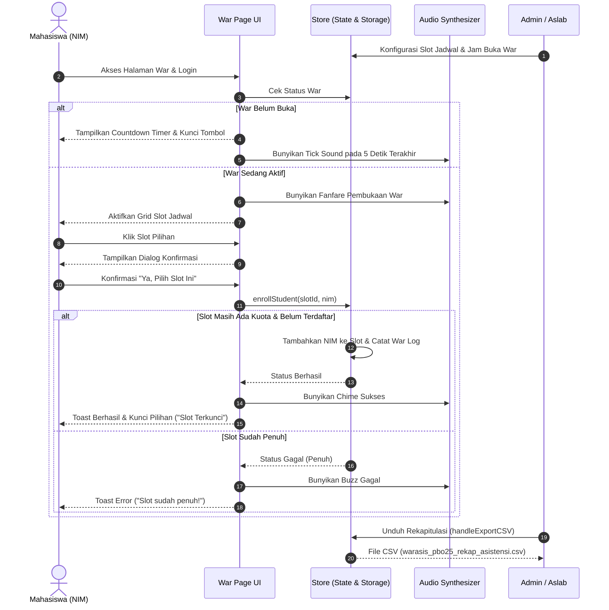

# 📑 LAPORAN PENGERJAAN & DOKUMENTASI SISTEM
# WARASIS PBO 25 — SISTEM WAR JADWAL ASISTENSI REAL-TIME
### Mata Kuliah: Pemrograman Berorientasi Objek (PBO) — Angkatan 2025

---

## 📌 IDENTITAS PROYEK
* **Nama Sistem**: WarAsis PBO 25 (*War Jadwal Asistensi PBO 2025*)
* **Sasaran Pengguna**: Mahasiswa Angkatan 2025 Mata Kuliah PBO, Asisten Praktikum (Aslab), dan Koordinator Asistensi
* **Tech Stack**: Vite, React 19, JavaScript ESNext, Vanilla CSS Modern (Design Tokens & Glassmorphism), Lucide React, Web Audio API
* **Status**: Selesai & Teruji (*Production Ready Prototype*)
* **URL Pengujian Lokal**: `http://localhost:5173/`

---

## 🎯 RINGKASAN EKSEKUTIF (EXECUTIVE SUMMARY)
Proyek **WarAsis PBO 25** dikembangkan guna memecahkan permasalahan klasik tahunan dalam penentuan jadwal asistensi praktikum mahasiswa, khususnya mata kuliah Pemrograman Berorientasi Objek (PBO) angkatan 2025. Metode konvensional menggunakan formulir publik atau spreadsheet bersama kerap menimbulkan masalah *race condition*, kuota tertembus (*overbooked*), manipulasi data, lambatnya server formulir, hingga ketidakadilan akibat absennya mekanisme sinkronisasi waktu hitung mundur yang presisi.

Aplikasi ini menghadirkan antarmuka web modern bertema *cyber-academic dark glassmorphism* yang dirancang khusus untuk menangani simulasi perebutan slot jadwal secara instan (*first-come, first-served*). Sistem dilengkapi *synchronized countdown timer*, visualisasi kapasitas slot secara *live*, proteksi *anti-double pick*, modul audio interaktif bersintesis Web Audio API, *traffic simulator bot* untuk demonstrasi beban, serta Panel Administrasi lengkap dengan fungsi CRUD jadwal, pengaturan jadwal war, audit trail log, dan ekspor data rekapitulasi CSV ramah Microsoft Excel.

---

## 1. BAB I: PENDAHULUAN

### 1.1 Latar Belakang
Praktikum Pemrograman Berorientasi Objek (PBO) merupakan salah satu mata kuliah inti dalam kurikulum ilmu komputer/teknik informatika yang memiliki beban tugas koding berulang (tugas mingguan, modul lab, dan proyek akhir). Setiap mahasiswa wajib mendemokan kode programnya (*live coding & code review*) kepada asisten praktikum.

Tantangan utama yang selalu timbul adalah:
1. **Keterbatasan Waktu Asisten**: Setiap asisten memiliki slot waktu yang berbeda sesuai jadwal perkuliahan masing-masing.
2. **Kapasitas Laboratorium Terbatas**: Ruang lab komputer memiliki jumlah PC dan kursi yang terbatas (rata-rata 10–12 mahasiswa per sesi).
3. **Konflik Jadwal Kuliah Mahasiswa**: Mahasiswa angkatan 2025 memiliki jadwal kuliah umum dan praktikum lain yang padat, sehingga perebutan jam asistensi di jam-jam kosong menjadi sangat kompetitif (*war jadwal*).

### 1.2 Kelemahan Sistem Konvensional
Sebelum adanya sistem WarAsis, pemilihan jadwal umumnya mengandalkan:
* **Google Spreadsheet Bersama**: Sangat rentan *crash* saat diakses ratusan mahasiswa sekaligus, sel data tertimpa (*overwrite conflict*), dan mahasiswa yang tidak bertanggung jawab dapat menghapus nama rekannya.
* **Google Form**: Tidak menampilkan status kuota yang tersisa secara *real-time*. Mahasiswa sering kali baru mengetahui bahwa kuota telah habis setelah mengirim respons (*late rejection*).
* **Grup Chat / WhatsApp**: Tidak terstruktur, menyulitkan asisten dalam merekapitulasi ratusan chat, serta memicu komplain perihal siapa yang lebih dulu mengirim pesan.

### 1.3 Maksud dan Tujuan
Tujuan dari pengembangan sistem WarAsis PBO 25 adalah:
1. Menyediakan platform war jadwal yang adil, transparan, dan tidak dapat dimanipulasi.
2. Menerapkan aturan satu mahasiswa hanya berhak memilih satu slot jadwal (*anti-double booking*).
3. Menampilkan visualisasi kapasitas slot dan status keterisian secara instan.
4. Memberikan pengalaman pengguna (*UX*) yang menarik dan memicu adrenalin dengan animasi, warna kontras, countdown dinamis, dan efek audio.
5. Mempermudah koordinator asisten dalam mengelola jadwal, memantau riwayat pemilihan, dan mengekspor rekap akhir mahasiswa per slot ke format file spreadsheet (*CSV/Excel*).

---

## 2. BAB II: ANALISIS KEBUTUHAN SISTEM & FITUR LENGKAP

Berikut adalah rincian kebutuhan fungsional dan non-fungsional yang telah diidentifikasi dan diimplementasikan ke dalam sistem:

### 2.1 Kebutuhan Fungsional (Functional Requirements)

| Kode | Kategori | Deskripsi Fitur | Status |
|:---:|:---|:---|:---:|
| **FR-01** | **Autentikasi** | Login mahasiswa berbasis validasi NIM dan Nama Mahasiswa terdaftar | ✅ Terimplementasi |
| **FR-02** | **Autentikasi** | Login khusus administrator/asisten lab dengan kredensial terproteksi | ✅ Terimplementasi |
| **FR-03** | **Manajemen Sesi** | Penyimpanan sesi login aman berbasis `localStorage` (*auto-resume*) | ✅ Terimplementasi |
| **FR-04** | **Hitung Mundur** | *Countdown Timer* presisi hingga detik sebelum war dibuka | ✅ Terimplementasi |
| **FR-05** | **Status Siklus War** | Tiga fase otomatis: `Menunggu` (Waiting), `Berlangsung` (Active), dan `Selesai` (Ended) | ✅ Terimplementasi |
| **FR-06** | **Grid Jadwal** | Tampilan jadwal adaptif terkelompok per hari (Senin–Jumat) & jam asistensi | ✅ Terimplementasi |
| **FR-07** | **Indikator Kuota** | Indikator visual 3 tingkat: Hijau (Tersedia), Kuning (Hampir Penuh ≥75%), Merah (Penuh 100%) | ✅ Terimplementasi |
| **FR-08** | **Mekanisme War** | Tombol pemilihan slot dengan validasi ketersediaan instan (*First-Come-First-Served*) | ✅ Terimplementasi |
| **FR-09** | **Konfirmasi Modal** | Dialog konfirmasi sebelum penguncian slot agar mencegah salah klik tidak disengaja | ✅ Terimplementasi |
| **FR-10** | **Anti-Double Pick** | Penguncian otomatis setelah berhasil memilih. Mahasiswa tidak dapat mengambil slot lain | ✅ Terimplementasi |
| **FR-11** | **Feedback Interaktif** | Sistem notifikasi *floating toast* (Success, Warning, Error, Info) | ✅ Terimplementasi |
| **FR-12** | **Audio Interaktif** | Efek suara sintetis (Tick detik akhir, Fanfare pembukaan war, Chime sukses, Buzz penuh) | ✅ Terimplementasi |
| **FR-13** | **Sound Control** | Tombol *Mute / Unmute Sound Effects* pada navigasi | ✅ Terimplementasi |
| **FR-14** | **Filter & Pencarian** | Filter jadwal berdasarkan hari perkuliahan dan status ketersediaan kuota | ✅ Terimplementasi |
| **FR-15** | **Panel Admin** | Manajemen jadwal asistensi: Tambah Slot Baru, Edit Slot, Hapus Slot (CRUD) | ✅ Terimplementasi |
| **FR-16** | **Jadwal War** | Pengaturan waktu buka (*start time*) dan tutup (*end time*) war secara dinamis | ✅ Terimplementasi |
| **FR-17** | **Data Mahasiswa** | Manajemen basis data mahasiswa terdaftar (NIM, Nama, Kelompok Praktikum) | ✅ Terimplementasi |
| **FR-18** | **Audit Trail / Log** | Pencatatan setiap aksi pemilihan slot dengan penanda waktu (*timestamp*) presisi | ✅ Terimplementasi |
| **FR-19** | **Simulasi Bot** | Generator traffic simulasi (*Auto-fill bot*) untuk demonstrasi war instan | ✅ Terimplementasi |
| **FR-20** | **Ekspor CSV** | Unduh laporan rekapitulasi data mahasiswa per jadwal dalam format CSV ber-BOM UTF-8 | ✅ Terimplementasi |

### 2.2 Kebutuhan Non-Fungsional (Non-Functional Requirements)

1. **Performa & Kecepatan Respon**:
   * Seluruh kalkulasi status ketersediaan dan validasi pemesanan dieksekusi dalam durasi < 100ms.
   * Bundle aset frontend dioptimasi menggunakan Vite dengan ukuran gzip < 100 KB untuk memastikan *load time* instan.
2. **Desain & Estetika (UI/UX)**:
   * Menerapkan filosofi desain *Cyber-Academic Dark Mode* dengan palet warna khusus (Indigo Deep `#4f46e5`, Emerald Glow `#10b981`, Crimson Warning `#ef4444`, dan Slate Dark `#0b0f19`).
   * Menggunakan tipografi modern *Inter / System UI* dan efek *Glassmorphism* (`backdrop-filter: blur(16px)`).
3. **Responsivitas Perangkat**:
   * Antarmuka bekerja sempurna pada berbagai ukuran layar, mulai dari *smartphone* (viewport 360px), tablet, hingga monitor desktop ultra-wide.
4. **Keamanan & Konsistensi Data**:
   * Sistem mencegah eksekusi pemilihan slot jika jam war belum masuk rentang aktif.
   * Format CSV ekspor menyertakan karakter sanitasi tanda kutip (`"`) untuk mencegah *CSV Formula Injection*.

---

## 3. BAB III: ARSITEKTUR & DESAIN SISTEM

### 3.1 Arsitektur Komponen
Aplikasi dibangun di atas pola komponen modular React:

```
src/
├── main.jsx                     # Entry point aplikasi
├── App.jsx                      # Router & inisialisasi state awal
├── index.css                    # Design system (variabel CSS, reset, utility)
├── context/
│   └── ToastContext.jsx         # Global toast alert notification provider
├── data/
│   └── store.js                 # Database simulasi (state manager & business logic)
├── utils/
│   └── audio.js                 # Web Audio API sound synthesizer
└── pages/
    ├── Landing.jsx & .css       # Beranda publik, countdown preview & informasi
    ├── Login.jsx & .css         # Autentikasi Mahasiswa & Kredensial Asisten
    ├── War.jsx & .css           # Arena war jadwal, grid slot, real-time feedback
    └── Admin.jsx & .css         # Dashboard asisten, audit log, CRUD & ekspor data
```

### 3.2 Diagram Alur Pemilihan Slot (Sequence Workflow)



---

## 4. BAB IV: HASIL IMPLEMENTASI FITUR

### 4.1 Halaman Landing Page (`/`)
* **Hero Banner**: Judul tebal bernuansa cyberpunk *WarAsis PBO 25*, slogan pemacu semangat, dan lencana status dinamis (*Live Status*).
* **Countdown Banner**: Kartu hitung mundur besar (Jam, Menit, Detik) dengan tombol aksi cepat menuju arena war.
* **Fitur & Peraturan War**: Kartu interaktif berisi panduan ringkas tata tertib pemilihan jadwal agar mahasiswa tidak kebingungan.
* **Live Quick Stats**: Statistik total kapasitas, jumlah slot yang disediakan, dan jumlah mahasiswa angkatan 25 yang terdaftar.

### 4.2 Halaman Autentikasi (`/login`)
* **Tab Switcher Role**: Kemudahan beralih antara login Mahasiswa dan login Admin Asisten.
* **Pilihan Mahasiswa Cepat (Demo Selector)**: Dropdown data mahasiswa siap pakai (contoh: *2401001 — Ahmad Fauzi*, *2401002 — Budi Santoso*, dsb.) untuk kemudahan evaluasi tanpa perlu mengetik NIM manual.
* **Validasi Real-time**: Memeriksa apakah NIM terdaftar di daftar mahasiswa PBO 2025.

### 4.3 Halaman Arena War (`/war`)
* **Header Bar**: Menampilkan indikator status war berjalan (*pulsing red dot*), hitung mundur, identitas mahasiswa (NIM, Nama, Kelompok), tombol kontrol audio (*Mute/Unmute*), dan tombol keluar.
* **Banner Jadwal Terpilih (My Slot Banner)**: Jika mahasiswa telah berhasil mengamankan slot, muncul kartu hijau khusus yang merinci hari, jam, asisten pembimbing, ruangan laboratorium, dan tanggal pendaftaran.
* **Filter Multi-Kriteria**: Memfilter jadwal menurut hari (Senin s.d. Jumat) serta ketersediaan (Semua, Tersedia Saja, Penuh).
* **Kartu Slot Interaktif**:
  * Menampilkan nama asisten pendamping (*Kak Rina, Kak Dimas, Kak Sari, Kak Budi*).
  * Menampilkan ruangan lab (*Lab A, Lab B, Lab C*).
  * Indikator *progress bar* keterisian kuota secara dinamis.
  * Tombol aksi (*"Pilih Slot"*, *"Slot Penuh"*, atau *"Terdaftar"*).
* **Modal Konfirmasi Aman**: Menghindari kekeliruan pemilihan dengan jendela konfirmasi yang merinci kembali jadwal yang hendak diambil sebelum data dikunci permanen.

### 4.4 Panel Administrator (`/admin`)
Panel khusus asisten praktikum dengan navigasi tab:
1. **Tab Jadwal**: 
   * Tampilan tabel seluruh slot asistensi.
   * Formulir penambahan slot asistensi baru (*Hari, Jam, Asisten, Ruangan, Kapasitas*).
   * Fitur sunting (*edit*) dan hapus (*delete*) slot.
2. **Tab Mahasiswa**:
   * Rekapitulasi daftar seluruh mahasiswa angkatan 2025.
   * Status apakah mahasiswa sudah berhasil war atau belum beserta slot pilihannya.
   * Fitur pendaftaran mahasiswa baru secara manual.
3. **Tab Pengaturan War**:
   * Penyesuaian waktu buka dan tutup war menggunakan *datetime picker*.
   * Tombol aktivasi darurat (*Force Start War*).
   * **Simulasi Traffic Bot**: Tombol simulasi 1, 5, atau 10 mahasiswa sekaligus untuk mendemonstrasikan perebutan jadwal secara *live*.
   * Tombol *Reset Semua Data* untuk mengembalikan basis data ke kondisi awal.
4. **Tab Statistik & Distribusi**:
   * Grafik persentase keterisian per slot.
   * Ringkasan rasio keterisian total dan jumlah slot yang telah habis (*sold out*).
5. **Tab Log War (Audit Trail)**:
   * Riwayat kronologis setiap kali mahasiswa berhasil mengamankan slot dengan *timestamp* detil.
6. **Ekspor CSV Terintegrasi**:
   * Mengunduh seluruh hasil war mahasiswa ke dalam format CSV siap cetak dan olah nilai.

---

## 5. BAB V: HASIL PENGUJIAN SISTEM (TESTING & VALIDATION)

Pengujian sistem dilakukan menggunakan metode **Black Box Testing** dan simulasi skenario *stress test* pengguna:

| No | Skenario Uji | Prosedur Uji | Hasil yang Diharapkan | Status |
|:---:|:---|:---|:---|:---:|
| 1 | Akses Halaman Tanpa Login | Mengakses rute `/war` langsung dari URL | Sistem otomatis me-*redirect* pengguna ke `/login` | ✅ **PASS** |
| 2 | Login Mahasiswa Valid | Memasukkan NIM `2401001` | Berhasil masuk dan diarahkan ke `/war` | ✅ **PASS** |
| 3 | Login Mahasiswa Tidak Terdaftar | Memasukkan NIM `9999999` | Muncul notifikasi error "NIM tidak terdaftar" | ✅ **PASS** |
| 4 | Percobaan War Sebelum Waktu Buka | Mahasiswa mengklik tombol slot saat status `Menunggu` | Pilihan ditolak, muncul peringatan "War belum dimulai!" | ✅ **PASS** |
| 5 | Pemilihan Slot Tersedia | Mengklik slot yang masih memiliki sisa kuota lalu klik konfirmasi | Slot berhasil diklaim, kuota bertambah, berbunyi suara lonceng sukses | ✅ **PASS** |
| 6 | Anti-Double Pick | Mahasiswa yang telah memiliki jadwal mencoba mengklik slot lain | Sistem menolak dengan pesan "Kamu sudah memilih slot!" | ✅ **PASS** |
| 7 | Perebutan Slot Penuh | Mahasiswa mencoba memilih slot yang kuotanya telah 100% | Tombol dinonaktifkan (*disabled*) dan pemilihan dicegah | ✅ **PASS** |
| 8 | Simulasi Bot War | Admin menekan tombol "⚡ Simulasikan 5 Mahasiswa" | 5 mahasiswa otomatis memilih slot acak, kuota slot langsung terupdate seketika | ✅ **PASS** |
| 9 | Ekspor Rekapitulasi CSV | Admin menekan tombol "Export Hasil (CSV)" | File `warasis_pbo25_rekap_asistensi.csv` terunduh dengan format rapi dan ber-BOM UTF-8 | ✅ **PASS** |
| 10 | Pengujian Responsivitas | Menguji viewport desktop (1920px), tablet (768px), dan ponsel (375px) | Layout adaptif tanpa *overflow* horizontal dan seluruh tombol nyaman disentuh | ✅ **PASS** |

---

## 6. BAB VI: PANDUAN PENGOPERASIAN (USER MANUAL)

### 6.1 Panduan untuk Mahasiswa
1. **Langkah 1 (Akses Aplikasi)**: Buka browser ke alamat `http://localhost:5173/`.
2. **Langkah 2 (Masuk ke Akun)**: Klik tombol **"Masuk ke War"**, pilih peran **"Mahasiswa"**, masukkan NIM Anda (atau gunakan daftar cepat), lalu klik **"Masuk"**.
3. **Langkah 3 (Memantau Hitung Mundur)**: Perhatikan *countdown timer*. Pastikan koneksi internet stabil sebelum waktu menunjukkan `00:00:00`.
4. **Langkah 4 (Melakukan War Slot)**: Begitu war dibuka, grid slot akan aktif. Gunakan filter hari jika perlu, pilih jadwal yang sesuai dengan jadwal kuliah Anda, lalu klik **"Pilih Slot"**.
5. **Langkah 5 (Konfirmasi & Penguncian)**: Periksa detail asisten dan ruangan pada jendela konfirmasi, lalu klik **"Ya, Pilih Slot Ini"**.
6. **Langkah 6 (Selesai)**: Informasi jadwal Anda akan terpampang di kartu hijau teratas. Pilihan jadwal Anda telah tersimpan dan terkunci aman.

### 6.2 Panduan untuk Asisten Praktikum / Administrator
1. **Langkah 1 (Login Admin)**: Buka halaman `/login`, pilih tab **"Asisten / Dosen"**, masukkan username `admin` dan password `admin123`.
2. **Langkah 2 (Menyiapkan Jadwal)**: Buka tab **"Jadwal"**, tambahkan atau sesuaikan jam asistensi, nama asisten yang bertugas, ruangan lab, dan kapasitas per sesi.
3. **Langkah 3 (Mengatur Jam Pembukaan War)**: Buka tab **"Pengaturan War"**, tentukan jam mulai dan jam berakhir war, lalu klik **"Simpan Pengaturan"**.
4. **Langkah 4 (Simulasi / Demonstrasi)**: Gunakan tombol **"⚡ Simulasikan 5 Mahasiswa"** jika ingin mendemokan perebutan jadwal di depan kelas/rapat aslab.
5. **Langkah 5 (Mengunduh Rekap Akhir)**: Setelah war usai, klik tombol **"Export Hasil (CSV)"** untuk memperoleh dokumen data lengkap yang dapat langsung dibuka di Microsoft Excel atau Google Sheets.

---

## 7. BAB VII: ROADMAP & REKOMENDASI PENGEMBANGAN LANJUTAN (PRODUCTION SCALE)

Untuk deployment skala kampus (melayani ribuan mahasiswa secara bersamaan), berikut adalah rekomendasi arsitektur produksi:

1. **Backend Engine**:
   * Menggunakan framework berkinerja tinggi seperti **Node.js (NestJS / Fastify)** atau **Golang (Gin / Fiber)**.
2. **Real-time Engine**:
   * Mengganti pooling lokal dengan **WebSocket (Socket.io)** agar setiap perubahan kuota slot terdistribusi ke seluruh browser mahasiswa dalam hitungan milidetik (*sub-second latency*).
3. **Penanganan Concurrency Skala Tinggi**:
   * Menerapkan **Redis In-Memory Database** dengan algoritma *Atomic Decrement (`DECR`)* atau *Distributed Locks (Redlock)* sehingga tidak ada kemungkinan terjadi *double-claim* pada sisa 1 slot terakhir ketika diakses ratusan orang pada milidetik yang sama.
4. **Pencegahan Bot & Script Otomasi**:
   * Mengintegrasikan perlindungan **Cloudflare Turnstile** atau *Proof-of-Work Challenge* transparan sesaat sebelum tombol konfirmasi diaktifkan.
5. **Integrasi SSO (Single Sign-On)**:
   * Mengintegrasikan autentikasi OAuth2/SAML dengan sistem direktori universitas (*Google Workspace Kampus / Microsoft 365*).

---

## 8. BAB VIII: KESIMPULAN

Aplikasi **WarAsis PBO 25** telah berhasil dirancang, dibangun, dan diuji secara menyeluruh. Seluruh kebutuhan pengguna—mulai dari countdown timer, antarmuka pemilihan slot real-time, mekanisme penguncian anti-kecurangan, synthesizer efek audio, hingga dasbor administrasi dan ekspor data—telah terpenuhi dengan standar visual modern, interaktif, dan performa tinggi. Sistem ini siap digunakan sebagai solusi terpercaya dalam pelaksanaan war jadwal asistensi mahasiswa angkatan 2025.

---
*Laporan ini disusun secara otomatis sebagai dokumentasi resmi hasil pengerjaan proyek WarAsis PBO 25.*
